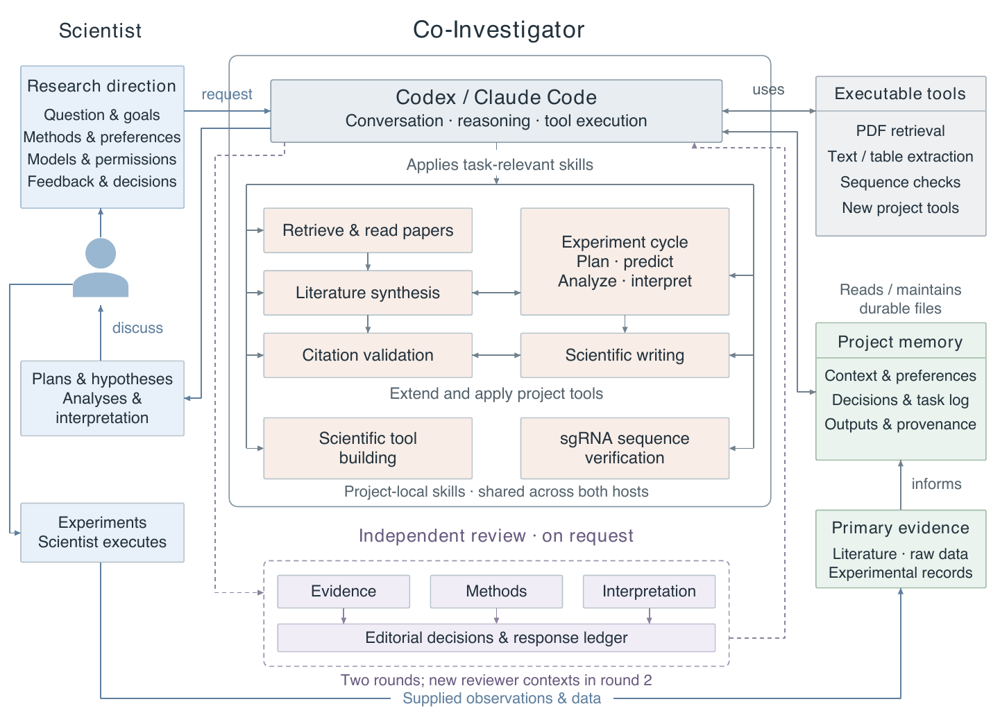

# Co-Investigator

A configurable scientific collaboration workspace for experimental scientists working with Codex or Claude Code. The scientist sets the questions, evidence standards, and working methods. The agent helps research, build tools, analyze results, and keep the project’s understanding current.

This framework grew out of day-to-day experimental biology work where a fixed research assistant offered too little control over methods and outputs. It packages the reusable collaboration structure and scientific skills. The original project’s research content and data are excluded.

## Start with your agent

Give Codex or Claude Code the repository URL or local folder and say:

> Set up this framework for my research project. Follow START_HERE.md, ask me for the project-specific decisions, and configure the workspace for how I want to work.

The agent handles the commands. You choose the research question, where files live, how much initiative the agent takes, how review works, and which tools to add. Setup targets macOS with Python 3.10 or newer and an installed, signed-in coding agent. It creates a separate project folder and leaves the template intact.

## What it provides

- **Literature with provenance.** Retrieve papers, keep a record of download attempts and source identifiers, read PDFs by page, and link claims to inspected evidence.
- **A controllable scientific workflow.** Develop competing hypotheses and discriminating tests, preserve your experimental records, and keep agent interpretations separate from observations.
- **Independent review.** Request a two-round review across evidence, methods, and interpretation, with a record of accepted and declined critiques.
- **Tools that grow with the project.** Ask for a primer-design script, analysis workflow, or other utility. The agent establishes its inputs and assumptions, checks it, and registers it alongside the work that uses it.
- **Continuity across sessions.** A compact current-context file links to the evidence and decisions that matter now; older conclusions remain traceable.



The [architecture guide](docs/architecture.md) maps this workflow to the implementation and includes editable SVG and vector PDF versions.

## Working together

You can ask: “Read these papers and show which evidence supports each explanation,” “Compare these results with our predictions,” or “Add a tool for this repeated calculation.” Change the collaboration rules in ordinary language. The agent records your choice in `context/collaboration.md` so the next session follows it.

The [skill guide](docs/skills.md) explains the included capabilities. [Collaboration](docs/collaboration.md) describes the records and control points. [Setup](START_HERE.md) contains the agent’s onboarding procedure.

## Check the framework

```sh
python3 tools/workspace.py check .
python3 -m unittest discover -s tests -v
```

These checks exercise workspace creation and tools with disposable software fixtures. There is no scientific demo or example research dataset.

[MIT license](LICENSE). This is a static release; it carries no ongoing maintenance commitment.
