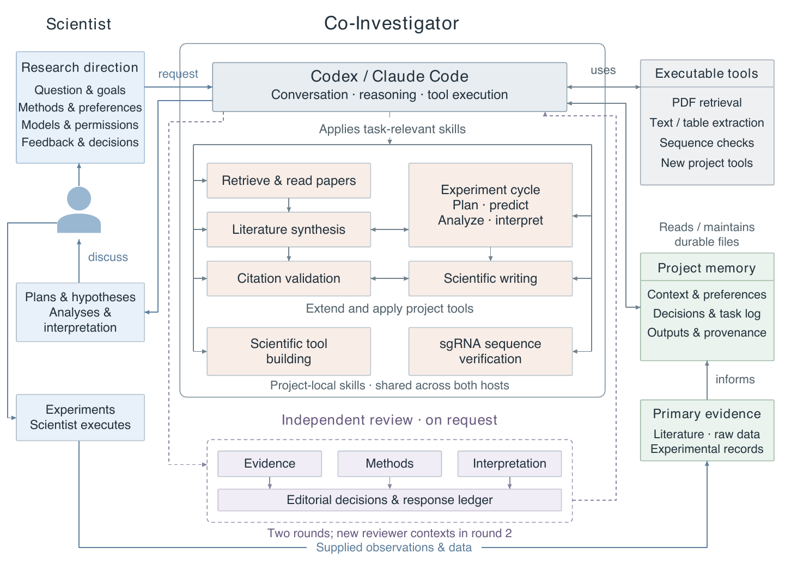

# Co-Investigator architecture

This workspace lets an experimental scientist direct a coding agent through ordinary language while keeping scientific choices, evidence, and methods in inspectable project files. The release supplies instructions, templates, and a small set of executable utilities. Codex or Claude Code supplies the model, conversation, tool execution, permissions, and any reviewer delegation.

**Figure 1. Co-Investigator: scientist-directed collaboration with persistent project records.** **a,** The scientist and agent move from evidence and competing explanations to an agreed plan. The scientist performs the experiment; the agent can analyze supplied observations and relate them to prior predictions. New evidence informs the next question. The arrows describe a working practice, not an automatically scheduled pipeline. **b,** The scientist controls scientific and operational choices through a collaboration agreement. The host agent follows project-local skills, invokes available utilities, and maintains derived outputs and context while preserving supplied primary records. Additional skills and checked tools can be added within the project. **c,** Independent review runs on request. Three separate review contexts examine evidence, methods, and interpretation; editorial decisions and revisions are recorded. A second round uses new independent contexts. This diagram describes the implemented collaboration structure and makes no claim about scientific performance.

The figure is original artwork. [Editable SVG](figures/architecture.svg), [vector PDF](figures/architecture.pdf), and [rendering instructions](figures/README.md) are included.

## One experimental cycle

The scientist states the research question and the decision an experiment should resolve. The agent reads the current context, inspects relevant sources, and develops competing explanations with distinguishing predictions. Before a plan is adopted, the scientist resolves the choices that affect its meaning: the experimental system, endpoint, controls, normalization, replication unit, exclusions, and acceptance criteria. The framework does not supply universal defaults for those choices.

Experimental execution remains with the scientist. The agent uses supplied observations and raw data to build an analysis whose commands, environment, input hashes, and checks are recorded. It separates measurements from statistical support and causal interpretation, links conclusions to primary records, and discusses consequential changes in direction. An inconclusive result can leave the next decision unresolved.

These steps are specified by the [literature-synthesis](../.agents/skills/literature-synthesis/SKILL.md) and [experiment-cycle](../.agents/skills/experiment-cycle/SKILL.md) skills. Their order can follow the actual task: a session may begin with new observations, a paper, a tool request, or a question about an earlier conclusion.

## Control and continuity

The scientist can change working methods in ordinary language, including how much initiative the agent takes, which decisions need discussion, the statistical approach, figure conventions, review depth, selected models, spending limits, and sharing rules. The agent records standing preferences in `context/collaboration.md` and consequential decisions with their rationale in `context/decisions.md`. These files guide later sessions; they are instructions followed by the host agent, rather than technical enforcement of permissions or scientific correctness.

`context/project-context.md` is a compact account of the current question, observations, working hypotheses, conflicting evidence, and next decision. Detailed evidence remains in linked artifacts. The agent updates this account when evidence changes the working view, keeps earlier conclusions available, and logs completed work. Continuity therefore depends on reading and maintaining these files; the release does not implement a separate memory service, database, or automatic retrieval index.

The [scientific-tool-building](../.agents/skills/scientific-tool-building/SKILL.md) skill extends the workspace when a task needs a new script or procedure. It requires an input/output contract, explicit scientific assumptions, checks using disposable inputs, and a record in `tools/registry.md`. Reusable project instructions live under `.agents/skills/`; relative links under `.claude/skills/` expose the same files to Claude Code. Adding a skill does not install a service or guarantee the host will select it automatically.

## What is executable

| Component | Implementation | Responsibility and boundary |
|---|---|---|
| Setup and structural checks | [`tools/workspace.py`](../tools/workspace.py), [`START_HERE.md`](../START_HERE.md) | Creates a separate project, copies templates and skills, creates Claude skill links, and checks expected files. It does not call a model or run a research cycle. |
| Host agent | Scientist's Codex or Claude Code installation | Interprets requests and instructions, reasons over evidence, runs authorized commands, and supplies supported delegation. The host and its model are external to this repository. |
| Scientific workflow | [Skill catalog](skills.md), `.agents/skills/*/SKILL.md` | Defines literature synthesis, experiment planning and interpretation, writing, citation checking, tool building, and requested review. These are natural-language procedures. |
| Literature retrieval | [`literature-pdf-download/scripts/`](../.agents/skills/literature-pdf-download/scripts/) | Executable helpers handle retrieval routes, downloads, corpus records, and an optional browser route. Access and dependencies vary by route; retrieval alone does not establish that a source supports a claim. |
| PDF inspection | [`read-pdf/pdf_cache.py`](../.agents/skills/read-pdf/pdf_cache.py), [`extract_tables.py`](../.agents/skills/read-pdf/extract_tables.py) | Executable helpers extract and cache page text or tables. The agent must still inspect relevant evidence and visual content. |
| Sequence verification | [`sgrna-sequence-verification/scripts/verify_sgRNA.py`](../.agents/skills/sgrna-sequence-verification/scripts/verify_sgRNA.py) | A bounded executable utility checks supplied sequence files against a cloning spreadsheet. It is one included utility, not a general experimental-design engine. |
| Persistent records | [`templates/project/context/`](../templates/project/context/), [`templates/project/tools/registry.md`](../templates/project/tools/registry.md) | Ordinary files preserve preferences, current understanding, decisions, completed work, and tool provenance. The agent maintains their content. |
| Independent review | [`adversarial-peer-review/SKILL.md`](../.agents/skills/adversarial-peer-review/SKILL.md) | An explicitly requested, two-round procedure requiring independent reviewer contexts. Delegation comes from the host or separate sessions; no review scheduler is included. |

Initialized projects separate `literature/` and `research/` from proposed `plans/`, primary `experiments/` and `data/`, derived `syntheses/`, review records in `reviews/`, and project utilities in `tools/`. Analysis scripts, configuration, and derived tables belong with the analysis they support. The template contains no research dataset or scientific demonstration.

## Review and publication use

Citation validation asks whether inspected sources support cited claims. Independent review asks broader questions about evidence, methods, and interpretation. Its editor records whether each critique is accepted, partly accepted, or declined, why, and what was changed. The procedure calls for three independent reviewers in each of two rounds; when the host cannot delegate, separate sessions are needed. A single agent rereading its own output cannot be reported as independent review.

The architecture can be documented as supporting methodology alongside experimental results. The release itself provides no measured improvement in discovery, accuracy, productivity, or experimental outcome. Software checks establish only the behaviors they exercise. Any future paper must supply its own experimental evidence, account of actual agent use, model and tool versions, intervention records, and limitations; adopting this workspace alone supplies none of those results.
